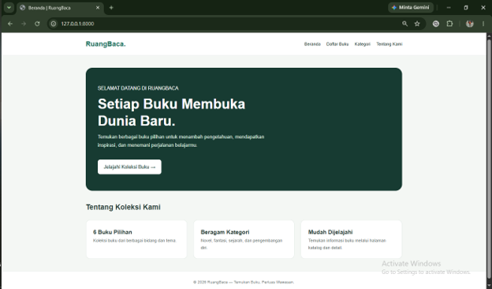
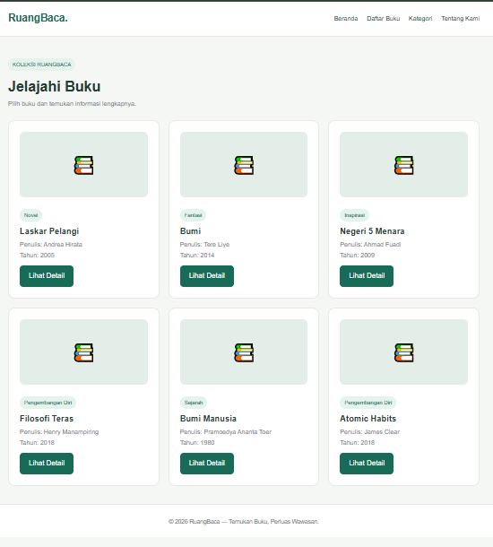
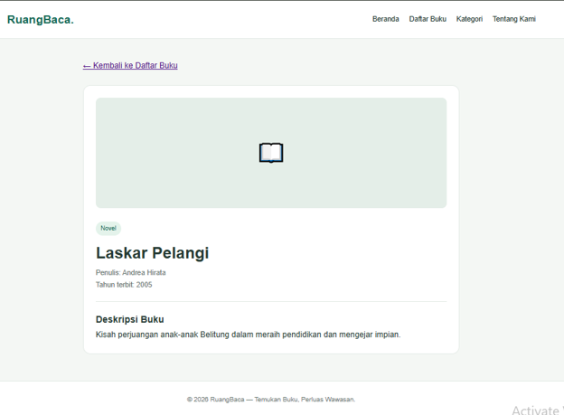

# RuangBaca — Aplikasi Katalog Buku

## Identitas Mahasiswa

- **Nama:** Riza Fitria
- **NIM:** C2483207031
- **Kelas:** PTI5A
- **Judul Proyek:** Implementasi Routing dan Konsep MVC Menggunakan Laravel

## Deskripsi Proyek

RuangBaca merupakan aplikasi katalog buku berbasis web yang dibuat menggunakan framework Laravel. Aplikasi ini menyediakan informasi koleksi buku, detail buku, kategori buku, dan informasi mengenai aplikasi.

Proyek ini dibuat untuk menerapkan konsep routing, Model-View-Controller (MVC), Controller, serta Blade Template pada Laravel.

Aplikasi menggunakan data statis berupa array PHP sehingga tidak memerlukan database.

## Fitur Aplikasi

1. Halaman beranda.
2. Daftar koleksi buku.
3. Detail informasi buku berdasarkan ID.
4. Daftar kategori buku.
5. Halaman tentang aplikasi.
6. Navigasi ant halaman.
7. Tampilan responsif untuk berbagai ukuran layar.

## Teknologi

- PHP
- Laravel
- Blade Template
- HTML
- CSS

## Implementasi Routing

Aplikasi memiliki lima route GET:

| URL | Fungsi |
|---|---|
| `/` | Menampilkan beranda |
| `/buku` | Menampilkan daftar buku |
| `/buku/{id}` | Menampilkan detail buku |
| `/kategori` | Menampilkan kategori buku |
| `/tentang` | Menampilkan informasi aplikasi |

Route `/buku/{id}` menggunakan parameter URL untuk menentukan buku yang akan ditampilkan.

## Implementasi Controller

Aplikasi menggunakan dua Controller:

- **HomeController:** menangani halaman beranda dan tentang kami.
- **BukuController:** menangani daftar buku, detail buku, dan kategori.

Data buku disimpan dalam array PHP pada `BukuController`, kemudian dikirim ke halaman Blade menggunakan `view()`.

## Implementasi View

Halaman menggunakan Blade Template Laravel.

- `layouts/app.blade.php`: layout utama.
- `beranda.blade.php`: halaman beranda.
- `buku/index.blade.php`: halaman daftar buku.
- `buku/detail.blade.php`: halaman detail buku.
- `kategori.blade.php`: halaman kategori.
- `tentang.blade.php`: halaman tentang kami.

Blade yang digunakan meliputi `@extends`, `@section`, `@yield`, `{{ }}`, dan `@foreach`.

## Screenshot Aplikasi

### 1. Beranda



### 2. Daftar Buku



### 3. Detail Buku



## Cara Menjalankan Aplikasi

### Persyaratan

- PHP yang sesuai dengan versi Laravel yang digunakan.
- Composer.
- Git.

### Langkah Menjalankan

1. Clone repositori:

   ```bash
   git clone URL_REPOSITORI_KAMU
   ```

2. Masuk ke folder proyek:

   ```bash
   cd katalog-buku
   ```

3. Instal dependensi:

   ```bash
   composer install
   ```

4. Jalankan aplikasi:

   ```bash
   php artisan serve
   ```

5. Buka `http://127.0.0.1:8000` di browser.

**Catatan:** Perintah di atas merupakan cara umum menjalankan proyek Laravel. Versi PHP harus sesuai dengan persyaratan proyek.

## Penutup

Proyek RuangBaca merupakan penerapan dasar routing, Controller, dan View menggunakan Laravel. Aplikasi ini dikembangkan sebagai media pembelajaran pengembangan web dengan data statis tanpa database.
